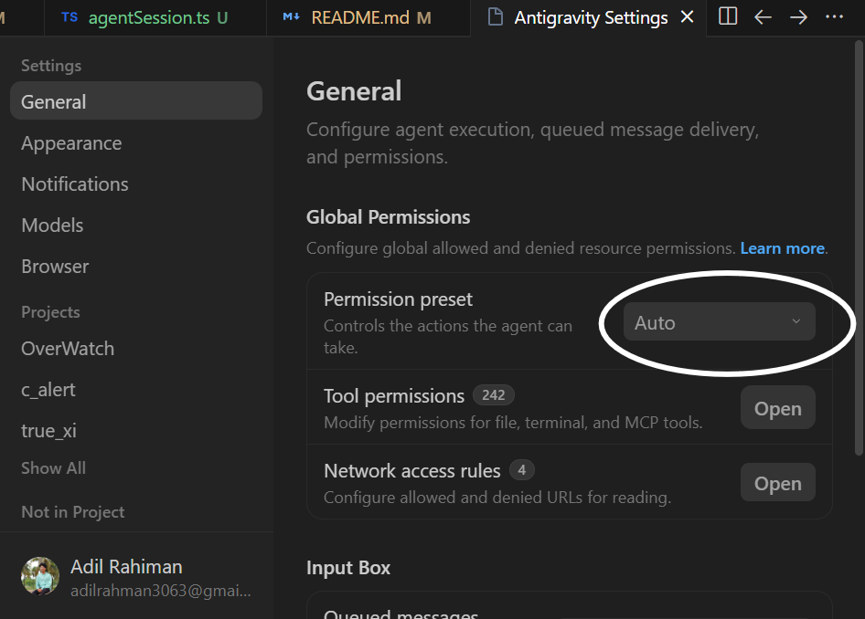

# 🛡️ OverWatch

> **Remote Deck for Windows**: Music & Media Controls, Antigravity & AI Agent Command Approvals, and Real-Time Quota Gauges for your phone.

> [!IMPORTANT]
> **Agent Support & Testing Notice**: Currently, **Google Antigravity** is the primary agent thoroughly tested and verified in live developer workflows. Hook templates for other agents (such as Claude Code) are provided as references; **please test and verify hook behavior in your specific environment before relying on it in critical workflows.**

---

## ⚡ What is OverWatch?

**OverWatch** turns your phone (iPhone / Android) into an interactive companion deck for your PC:
1. 🕰️ **3D Split-Flap Clock & Sprint Timer**: Nostalgic mechanical flip clock with synthesized Web Audio leaf clicks and customizable focus sprint timers (+1m/+5m steppers & presets).
2. 🎵 **Windows Music Control**: Real-time multi-session GSMTC detection (Spotify, Chrome YouTube Music, etc.) with Play/Pause, Next/Prev, and isolated track scrubber.
3. 🛡️ **Agent Command Approvals**: Strict fail-closed interceptor for `run_command` from **Antigravity** and **Claude Code**. Review command preview on your phone with audible alarm and 1-tap **Allow** / **Deny**.
4. 🤖 **AI Mission Control**: Live session telemetry (active model, step count, current objective, tool stream), 1-tap preloaded prompt deck (Continue, Find the Bug, Commit & Push), and mobile custom command creator.
5. 🚀 **Remote Git Push Engine**: Detects when an agent finishes outside the sandbox with uncommitted/unpushed changes, reminds you on mobile with exact command, and lets you 1-tap **Beam & Push via Windows** to run git push natively on the host PC!
6. 📊 **Hardware Telemetry & Quotas**: Live CPU, RAM, battery, active window, and Antigravity model quotas.
7. 👻 **Silent Windows System Tray**: Runs cleanly in the Windows notification area (`^`) with custom vector icon and context menu.
8. ⚡ **Zero Port Forwarding**: Powered by **Supabase Realtime**, working securely over cellular data or Wi-Fi with sub-100ms latency.

---

## 📸 Product Showcase & Preview

<!-- Place your product screenshot or animated demo below -->
<div align="center">
  
  <p><em>Turn your phone into an ambient OLED companion deck for your PC workstation.</em></p>
</div>

| 🕰️ Screen 1: Retro Flip Clock & Timer | 🎵 Screen 2: Multi-Session Music & PC Telemetry |
|:---:|:---:|
|  |  |

| 🤖 Screen 3: AI Mission Control & Git Push Beam | ⚡ Screen 4: Workstation Macros & Clipboard Beam |
|:---:|:---:|
|  |  |

---

## 🏗️ Architecture

```
┌─────────────────────────────────┐           ┌─────────────────────────────────┐
│         Windows Client          │           │       iPhone / Web App (PWA)    │
│  (OverWatch Node.js Daemon)     │           │       (Vite React / Tailwind)   │
└──────────────┬──────────────────┘           └────────────────┬────────────────┘
               │                                               │
               │         Supabase Realtime Channel             │
               │        (e.g., "overwatch:default")            │
               │                                               │
               ├─────── 1. Broadcast "media:state" ───────────►│ (Shows current song & artist)
               │◄────── 2. Broadcast "media:action" ───────────┤ (Tap Play/Pause/Next/Prev)
               │                                               │
               ├─────── 3. Broadcast "quota:state" ───────────►│ (Live Gemini/Claude gauges)
               │                                               │
               │ [Antigravity/Claude asks permission]          │
               ├─────── 4. Push "permission:request" ─────────►│ (Alerts phone: Command preview)
               │◄────── 5. Push "permission:decision" ─────────┤ (You tap [ALLOW] or [DENY])
               ▼                                               ▼
```

---

## 🚀 1-Click Windows Setup (Recommended)

Simply double-click **`setup.bat`** in the project root *(or run `.\setup.ps1` in PowerShell)*.

The script automatically handles everything:
1. **Verifies Prerequisites**: Checks Node.js (v18+) and npm.
2. **Configures Credentials**: Sets up `client/.env` and `web/.env` with your Supabase credentials.
3. **Installs Dependencies**: Runs `npm install` across both `client/` and `web/`.
4. **Builds Everything**: Compiles the client daemon and builds the web PWA.
5. **Generates Tray Icon**: Renders `overwatch.ico` for Windows notification area.
6. **Registers Agent Hooks**: Hooks into Antigravity (`~/.gemini/config/hooks.json`) and Claude Code.
7. **Windows Startup**: Optionally registers OverWatch in the Windows Startup folder.
8. **Launches**: Starts OverWatch silently in the Windows System Tray!

---

## 🛠️ Manual Step-by-Step Setup

### 1. Database Setup (Supabase)
1. Create a free project at [supabase.com](https://supabase.com).
2. Go to **SQL Editor** -> **New Query**, copy the contents of [`supabase/schema.sql`](file:///c:/Users/adilr/Documents/open-source/OverWatch/supabase/schema.sql) and click **Run**.
3. Note your **Project URL** and **Anon Key** from *Project Settings -> API*.

### 2. Windows Client Setup
```bash
cd client
cp .env.example .env
# Edit .env and paste your SUPABASE_URL and SUPABASE_ANON_KEY

npm install
npm run build
npm start
```

### 3. Install Agent Hooks
To enable remote approval for Antigravity (and Claude Code):
```bash
cd client
npm run setup:hooks
```
*(You can uninstall anytime with `npx tsx src/cli/setupHooks.ts --remove`)*

> [!NOTE]
> Only **Antigravity** has been extensively tested with live terminal hooks. If using Claude Code or another coding agent, please run test commands first to confirm that permission blocking and timeouts behave as expected on your system.

#### ⚙️ Setting to Configure in Antigravity IDE (Mobile Interlock Mode)
To turn your phone into the exclusive hardware token so you don't have to click review prompts on your monitor:

1. Open **Antigravity IDE**.
2. Open **Settings** (or press `Ctrl+,`) and click the **Antigravity Settings** tab.
3. Under **General** ➔ **Global Permissions**:
   - Locate the **Permission preset** dropdown.
   - Select **Auto** (as shown in the screenshot below).
   - In **Auto** mode, Antigravity delegates command approvals directly to OverWatch's PreToolUse lifecycle hook.
   - When Antigravity prepares a terminal command, your phone rings with the command preview. You tap **Allow** on mobile, and the command executes immediately on your laptop — **zero clicks needed on your desktop!**

<div align="center">
  
  <p><em>Antigravity Settings &gt; General &gt; Global Permissions &gt; Permission preset: Auto</em></p>
</div>

### 4. Web App (PWA) Setup
```bash
cd web
npm install
npm run dev
```
Open the web app URL on your iPhone Safari, tap **Share** -> **Add to Home Screen**, and launch full-screen!

### 5. Silent Background Mode (System Tray)
To run OverWatch without keeping a terminal window open on your desktop:
- Double-click **`start-tray.bat`** in the project root.
- The **OverWatch icon** will appear in your Windows System Tray (notification overflow area `^`).
- Right-click the tray icon to view live logs, open the web deck, restart, or exit.
- To automatically start in the system tray on Windows boot:
  ```powershell
  powershell -ExecutionPolicy Bypass -File client/scripts/install-startup.ps1
  ```

<div align="center">
  
  <p><em>OverWatch Client running silently in the Windows System Tray</em></p>
</div>

---

## 🔒 Security
- **Fail-Safe / Fail-Closed**: If the OverWatch daemon is offline or a request times out, it gracefully falls back to local terminal prompts so your workflow is never locked out.
- **No Command Injection**: The phone can only send `allow` or `deny` responses for specific request IDs. It can never send arbitrary terminal commands to your PC.

---

## 📄 License
MIT © 2026 Adil Rahman
